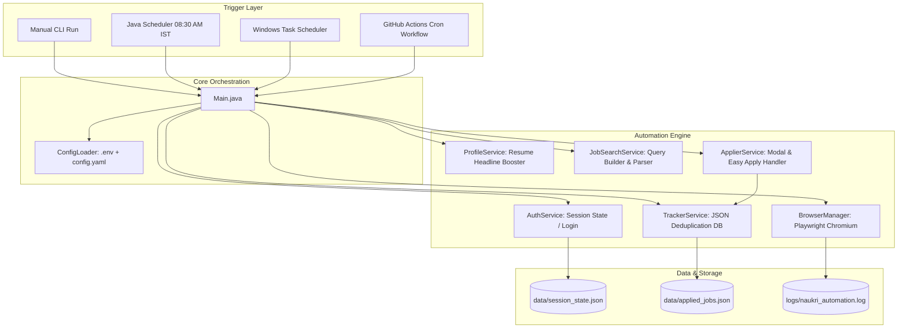
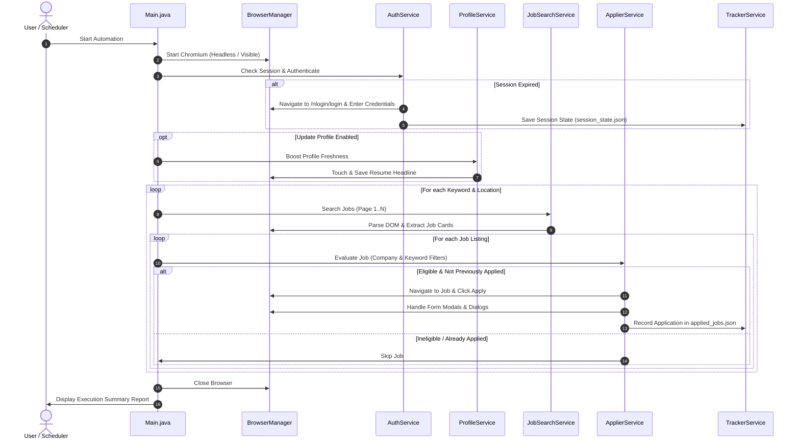

# Naukri.com Job Automation & Profile Booster — Comprehensive Technical Documentation

---

## Table of Contents
1. [Executive Summary & Purpose](#1-executive-summary--purpose)
2. [Architecture & System Design](#2-architecture--system-design)
3. [Technology Stack & Dependencies](#3-technology-stack--dependencies)
4. [Project Structure](#4-project-structure)
5. [Configuration Specifications](#5-configuration-specifications)
   - [5.1 Environment Variables (`.env`)](#51-environment-variables-env)
   - [5.2 Job Search & Filtering (`config.yaml`)](#52-job-search--filtering-configyaml)
   - [5.3 Logging Configuration (`logback.xml`)](#53-logging-configuration-logbackxml)
6. [Core Component Breakdown](#6-core-component-breakdown)
   - [6.1 Browser Engine & Anti-Detection (`BrowserManager`)](#61-browser-engine--anti-detection-browsermanager)
   - [6.2 Authentication & Session Persistence (`AuthService`)](#62-authentication--session-persistence-authservice)
   - [6.3 Profile Freshness Booster (`ProfileService`)](#63-profile-freshness-booster-profileservice)
   - [6.4 Search Query Engine & Scraper (`JobSearchService`)](#64-search-query-engine--scraper-jobsearchservice)
   - [6.5 Application Engine & Modal Handler (`ApplierService`)](#65-application-engine--modal-handler-applierservice)
   - [6.6 Application History & Deduplication (`TrackerService`)](#66-application-history--deduplication-trackerservice)
   - [6.7 Timezone-Aware Daily Scheduler (`Scheduler`)](#67-timezone-aware-daily-scheduler-scheduler)
   - [6.8 Orchestration & CLI Entrypoint (`Main`)](#68-orchestration--cli-entrypoint-main)
7. [End-to-End Workflow & Execution Flows](#7-end-to-end-workflow--execution-flows)
8. [Installation, Compilation & Local Run Guide](#8-installation-compilation--local-run-guide)
9. [Automated Scheduling Options](#9-automated-scheduling-options)
   - [Option A: Windows Task Scheduler (Local Background)](#option-a-windows-task-scheduler-local-background)
   - [Option B: GitHub Actions (Free Serverless Cloud Runner)](#option-b-github-actions-free-serverless-cloud-runner)
   - [Option C: Daemon Process (Built-in Java Scheduler)](#option-c-daemon-process-built-in-java-scheduler)
10. [Troubleshooting & FAQ](#10-troubleshooting--faq)
11. [Security, Ethics & Account Safety Guidelines](#11-security-ethics--account-safety-guidelines)

---

## 1. Executive Summary & Purpose

The **Naukri Automation Bot** is a high-reliability, automated daily job application and profile optimization system built in **Java 17** using **Microsoft Playwright**. 

### Primary Objectives:
1. **Recruiter Visibility Optimization**: Naukri ranks candidate profiles primarily by freshness ("Updated Today" badge). The bot automatically accesses the user's profile every morning at **8:30 AM IST** and updates the resume headline, keeping the profile at the top of recruiter searches.
2. **Automated Targeted Applications**: Scrapes relevant job postings based on customizable keywords (e.g. *Full Stack Developer*, *Java Developer*), experience ranges, locations, and age filters (posted within 24h), executing 1-Click "Easy Apply" directly on the portal.
3. **Safety & Deduplication**: Employs human-like random delays, anti-detection flags, and local JSON history tracking to prevent duplicate applications and safeguard against account bans or rate limits.

---

## 2. Architecture & System Design



---

## 3. Technology Stack & Dependencies

| Layer | Component | Version | Purpose |
|---|---|---|---|
| **Language** | Java Development Kit (JDK) | 17+ (LTS) / 18 / 21 | Modern standard Java runtime |
| **Browser Engine** | Microsoft Playwright Java | 1.49.0 | High-performance, multi-tab Chromium automation |
| **Data Serialization** | Jackson Core / Databind | 2.18.2 | JSON history reading and writing |
| **Config Serialization** | Jackson Dataformat YAML | 2.18.2 | `config.yaml` structured parsing |
| **Logging Framework** | SLF4J + Logback Classic | 2.0.16 / 1.5.16 | Console colorized & rolling file logger |
| **Packaging** | Maven Shade Plugin | 3.5.3 | Bundles dependencies into an all-in-one Fat JAR |

---

## 4. Project Structure

```text
naukri-automation/
├── pom.xml                                  # Maven project configuration & Fat JAR plugin
├── .env.example                             # Template for user credentials and runtime flags
├── .env                                     # Local environment file (Ignored in Git)
├── config.yaml                              # Job search keywords, filters, and criteria
├── run_daily.bat                            # Windows batch execution script
├── setup_windows_task.ps1                   # Windows Task Scheduler auto-registration
├── README.md                                # Quick-start documentation
├── DOCUMENTATION.md                         # Full technical documentation
├── .github/
│   └── workflows/
│       └── daily_naukri.yml                # Cloud GitHub Actions workflow (08:30 AM IST)
├── data/
│   ├── session_state.json                   # Encrypted browser cookies & local storage
│   └── applied_jobs.json                    # Deduplication database of applied job IDs
├── logs/
│   └── naukri_automation.log                # Daily rolling execution logs
└── src/
    └── main/
        ├── resources/
        │   └── logback.xml                  # Log pattern and log rotation policy
        └── java/com/naukri/automation/
            ├── Main.java                    # Entrypoint & CLI execution coordinator
            ├── Scheduler.java               # Daily 08:30 AM IST cron scheduler
            ├── config/
            │   ├── AppConfig.java           # Strong-typed Java POJO configuration model
            │   └── ConfigLoader.java        # YAML and .env parser
            ├── browser/
            │   └── BrowserManager.java      # Playwright Chromium manager with stealth flags
            ├── service/
            │   ├── AuthService.java         # Login and OTP detection handler
            │   ├── ProfileService.java      # Profile headline touch optimizer
            │   ├── JobSearchService.java    # Search query generator & DOM scraper
            │   ├── ApplierService.java      # Easy-apply clicker & modal questionnaire handler
            │   └── TrackerService.java      # JSON history tracker and counter
            └── model/
                ├── JobListing.java          # Model representing a discovered job
                ├── AppliedJobInfo.java      # Model representing an applied job history record
                └── AutomationStats.java     # Metrics model (Scanned, Applied, Skipped)
```

---

## 5. Configuration Specifications

### 5.1 Environment Variables (`.env`)

```properties
# Your Naukri account credentials
NAUKRI_EMAIL=your_email@example.com
NAUKRI_PASSWORD=your_naukri_password

# Set to false for first run (to solve OTP/Captcha manually if prompted), true for headless
HEADLESS=false

# Enable or disable the daily profile headline freshness boost
UPDATE_PROFILE=true

# Safety limits
MAX_APPLICATIONS_PER_RUN=25

# Scheduler configuration
SCHEDULE_TIME=08:30
TIMEZONE=Asia/Kolkata
```

### 5.2 Job Search & Filtering (`config.yaml`)

```yaml
# Search Parameters
search_criteria:
  keywords:
    - "Full Stack Developer"
    - "React Developer"
    - "Java Backend Developer"
  locations:
    - "Bengaluru"
    - "Hyderabad"
    - "Remote"
  experience:
    min: 2
    max: 5
  freshness_days: 1          # 1 = Posted in the last 24 hours
  min_salary_lakhs: 12       # Optional minimum salary filter

# Exclusions and Safety Filters
filters:
  exclude_companies:
    - "Confidential"
    - "Staffing"
    - "CyberCoders"
  exclude_title_keywords:
    - "Intern"
    - "Trainee"
    - "Tech Lead"
    - "Architect"
  easy_apply_only: true      # Skips external company website redirects

# Automation Pacing
application:
  min_delay_seconds: 4.0     # Minimum delay between applications
  max_delay_seconds: 8.0     # Maximum delay between applications
  max_pages_per_keyword: 3   # Max pagination depth per search keyword
  daily_max_applications: 30

# Storage Locations
storage:
  applied_history_file: "data/applied_jobs.json"
  session_file: "data/session_state.json"
```

### 5.3 Logging Configuration (`logback.xml`)

Located at [`src/main/resources/logback.xml`](src/main/resources/logback.xml):
- **Console Appender**: Colorized output with thread, severity level, class name, and message.
- **Rolling File Appender**: Writes to `logs/naukri_automation.log`, rolling over daily into `logs/naukri_automation-yyyy-MM-dd.log` with a 30-day retention window.

---

## 6. Core Component Breakdown

### 6.1 Browser Engine & Anti-Detection (`BrowserManager`)
[`com.naukri.automation.browser.BrowserManager`](src/main/java/com/naukri/automation/browser/BrowserManager.java) manages the browser lifecycle.
- **Stealth Initialization**: Injects JavaScript before any page loads to mask bot footprints:
  ```javascript
  Object.defineProperty(navigator, 'webdriver', { get: () => undefined });
  Object.defineProperty(navigator, 'languages', { get: () => ['en-IN', 'en-US', 'en'] });
  ```
- **Session Preservation**: Loads and exports authentication cookies to `data/session_state.json`.
- **Human Delay**: Implements randomized delays between `min_delay_seconds` and `max_delay_seconds` to emulate human browsing.
- **Diagnostic Screenshots**: Automatically captures error screenshots into `data/debug_screenshots/` whenever an exception occurs.

### 6.2 Authentication & Session Persistence (`AuthService`)
[`com.naukri.automation.service.AuthService`](src/main/java/com/naukri/automation/service/AuthService.java) handles user logins.
1. Checks if the saved session is valid by navigating to `/mnjuser/profile`.
2. If unauthenticated, navigates to `https://www.naukri.com/nlogin/login`.
3. Types credentials using randomized keystroke delay (`pressSequentially(..., delay=60ms)`).
4. Detects OTP challenges. If `HEADLESS=false`, allows 60 seconds for the user to enter the OTP in the visible window, then saves the authenticated session state.

### 6.3 Profile Freshness Booster (`ProfileService`)
[`com.naukri.automation.service.ProfileService`](src/main/java/com/naukri/automation/service/ProfileService.java) keeps profile ranking high.
- Navigates to `/mnjuser/profile`.
- Locates the **Resume Headline** edit button.
- Toggles a trailing period (`.` <-> ``) at the end of the existing text.
- Clicks **Save**.
- This modification triggers Naukri's update timestamp, tagging your profile with the green **"Updated Today"** badge in recruiter search algorithms.

### 6.4 Search Query Engine & Scraper (`JobSearchService`)
[`com.naukri.automation.service.JobSearchService`](src/main/java/com/naukri/automation/service/JobSearchService.java) discovers jobs.
- Constructs clean SEO URLs formatted according to Naukri conventions:
  `https://www.naukri.com/{keyword}-jobs-in-{location}?experience={min}&jobAge={days}`
- Scrolls through the search results page to trigger lazy loading of job cards.
- Extracts Job ID, Job Title, Company Name, Location, Apply URL, and Easy Apply flags.

### 6.5 Application Engine & Modal Handler (`ApplierService`)
[`com.naukri.automation.service.ApplierService`](src/main/java/com/naukri/automation/service/ApplierService.java) executes applications.
- Validates job against exclusion rules (excluded company names, forbidden title terms).
- Checks if the job was already applied to in `data/applied_jobs.json`.
- Clicks the **Apply** button.
- Handles application dialogues, confirmation modals, and questionnaire pop-ups.
- Records successful applications into [`TrackerService`](src/main/java/com/naukri/automation/service/TrackerService.java).

### 6.6 Application History & Deduplication (`TrackerService`)
[`com.naukri.automation.service.TrackerService`](src/main/java/com/naukri/automation/service/TrackerService.java) prevents duplicate applications.
- Maintains `data/applied_jobs.json` with structure:
  ```json
  {
    "applied_jobs": {
      "12345678": {
        "title": "Full Stack Java Developer",
        "company": "Infosys",
        "location": "Bengaluru",
        "url": "https://www.naukri.com/job-listings-12345678",
        "applied_at": "2026-11-11T08:30:15",
        "status": "APPLIED"
      }
    }
  }
  ```
- Calculates daily application counts and total lifetime applications.

### 6.7 Timezone-Aware Daily Scheduler (`Scheduler`)
[`com.naukri.automation.Scheduler`](src/main/java/com/naukri/automation/Scheduler.java) provides continuous execution.
- Computes exact duration until the next target run time (e.g., 08:30:00) in the `Asia/Kolkata` timezone.
- Uses `java.util.concurrent.ScheduledExecutorService` to trigger the job loop every 24 hours.

### 6.8 Orchestration & CLI Entrypoint (`Main`)
[`com.naukri.automation.Main`](src/main/java/com/naukri/automation/Main.java) coordinates configuration loading, browser lifecycle, profile booster, search, applier, and outputs a formatted terminal report:

```text
+-------------------------------------------------------------+
|                   DAILY RUN SUMMARY REPORT                  |
+------------------------------------+------------------------+
| Jobs Scanned                       | 48                     |
| Jobs Eligible                      | 18                     |
| Jobs Applied Today                 | 15                     |
| Jobs Skipped / Already Applied     | 33                     |
| Profile Freshness Boosted          | Yes                    |
| Total History Applications         | 142                    |
+------------------------------------+------------------------+
```

---

## 7. End-to-End Workflow & Execution Flows



---

## 8. Installation, Compilation & Local Run Guide

### Step 1: Install Prerequisites
1. **JDK 17 or higher**: [Adoptium Temurin JDK](https://adoptium.net/)
2. **Maven 3.8+**: Included or downloaded.

### Step 2: Build the Application
```powershell
mvn clean package -DskipTests
```
*Creates the standalone runnable fat JAR at `target/naukri-automation.jar`.*

### Step 3: Configure `.env`
```powershell
Copy-Item .env.example .env
```
Fill in your `NAUKRI_EMAIL` and `NAUKRI_PASSWORD`.

### Step 4: Run Once
```powershell
java -jar target/naukri-automation.jar
```

---

## 9. Automated Scheduling Options

### Option A: Windows Task Scheduler (Local Background)
Run PowerShell as Administrator:
```powershell
powershell -ExecutionPolicy Bypass -File setup_windows_task.ps1
```
*Registers a Windows Scheduled Task `NaukriDailyJobApply` that triggers `run_daily.bat` every morning at 8:30 AM IST.*

### Option B: GitHub Actions (Free Serverless Cloud Runner)
1. Push this project to a **Private** GitHub repository.
2. In GitHub, navigate to **Settings** > **Secrets and variables** > **Actions**.
3. Create two secrets:
   - `NAUKRI_EMAIL`
   - `NAUKRI_PASSWORD`
4. The workflow in [`.github/workflows/daily_naukri.yml`](.github/workflows/daily_naukri.yml) runs every morning at **03:00 UTC (08:30 AM IST)** in the cloud.

### Option C: Daemon Process (Built-in Java Scheduler)
Run in any background terminal / server:
```powershell
java -jar target/naukri-automation.jar --run-now
```

---

## 10. Troubleshooting & FAQ

### Q1: Naukri asks for OTP on first login.
- **Solution**: Set `HEADLESS=false` in `.env`. Run `java -jar target/naukri-automation.jar`. Complete the OTP prompt once in the visible browser. The session state is saved to `data/session_state.json`. You can then turn `HEADLESS=true` back on.

### Q2: How can I change search keywords or locations?
- **Solution**: Edit [`config.yaml`](config.yaml) under `search_criteria.keywords` and `search_criteria.locations`.

### Q3: How do I change the daily execution time?
- **Solution**: Change `SCHEDULE_TIME=08:30` in `.env` to your preferred 24-hour time (e.g. `09:15`).

### Q4: Maven build fails with "Playwright driver not found".
- **Solution**: Run `mvn clean package -DskipTests` to download the bundled Playwright platform driver.

---

## 11. Security, Ethics & Account Safety Guidelines

1. **Keep Repository Private**: Never commit `.env` or `data/session_state.json` to public repositories.
2. **Reasonable Daily Limits**: Do not exceed 30–50 applications per day to ensure your account remains within normal human recruiter metrics.
3. **Pacing Delays**: Keep `min_delay_seconds: 4.0` and `max_delay_seconds: 8.0` active to emulate natural human browsing rhythms.
